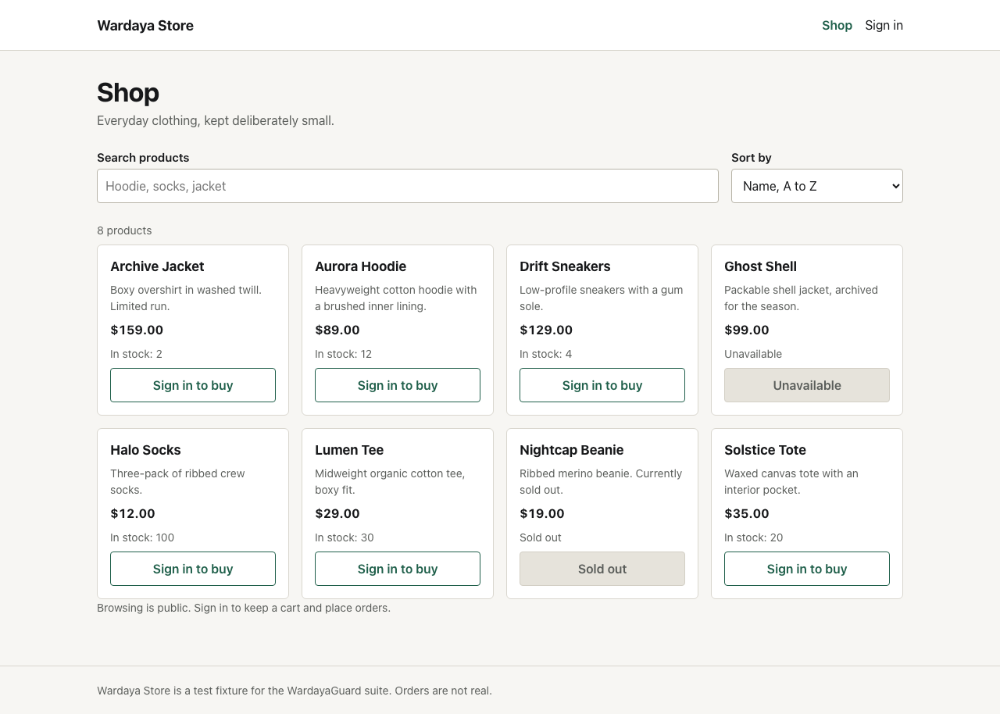
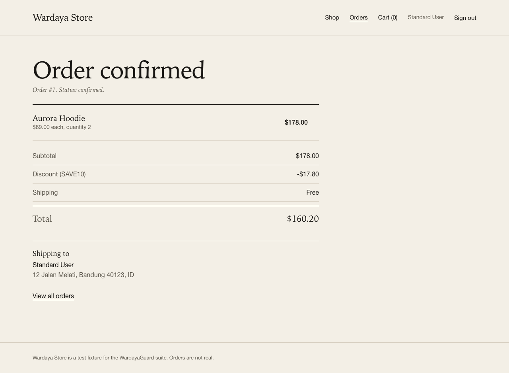
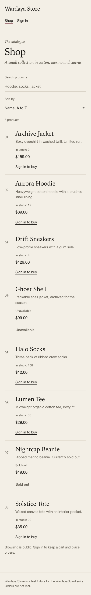

# WardayaGuard

**Regression test suite for Wardaya Store, a seeded e-commerce stack.**
TypeScript, Playwright, Vitest, React, Express, SQLite, GitHub Actions.

[](https://github.com/fawwazmw/wardayaguard/actions/workflows/ci.yml) [](https://github.com/fawwazmw/wardayaguard/actions/workflows/nightly.yml)

**Live test report:** https://fawwazmw.github.io/wardayaguard/

Wardaya Store is the system under test. WardayaGuard is the harness that proves
its pricing, inventory, checkout, authorization and customer-journey rules hold.

> **Status: working end to end.** API, storefront and both test layers are
> implemented. Every number below comes from a real local run on 2026-10-30.

## Current results

| Suite                                  | Tests  | Status      |
| -------------------------------------- | ------ | ----------- |
| Unit (pricing rules)                   | 13     | Passing     |
| API (contract, authz, checkout, stock) | 52     | Passing     |
| UI (customer journeys, Chromium)       | 23     | Passing     |
| **Total**                              | **88** | **Passing** |

Latest run: Node 24.18.0, macOS, Chromium 156, seed reset before every test.
Playwright: 75 tests. Vitest: 13 tests. Typecheck, ESLint and Prettier are clean.

CI runs the API suite and the Chromium UI suite on every push and pull request.
The nightly matrix runs the same 23 UI cases on Chromium, Firefox and WebKit,
one job per browser, 69 UI executions per night. Latest nightly:
[41020839448](https://github.com/fawwazmw/wardayaguard/actions/runs/41020839448),
all three green.

## Screenshots







## What the suite actually demonstrates

- **Business rules, not button clicks.** Totals are asserted as exact integers
  from the API and from a pure pricing module, including the 4999 versus 5000
  cent shipping boundary and half-up rounding.
- **Idempotent checkout.** Replaying the same `Idempotency-Key` returns the
  original order with `200` and `replayed: true`: one order row, one stock
  decrement.
- **No overselling.** Two customers hold the last two units at the same time.
  Exactly one checkout succeeds and stock lands on zero.
- **Authorization.** A second customer reading the first customer's order gets
  `404`, not `403`, so the API does not confirm the id exists. The UI test
  repeats the attempt through the browser.
- **Information leakage.** A thrown server fault returns a generic `500` with
  no stack trace and no internal message.
- **Real journeys.** Login, catalogue search and sort, cart quantity change,
  checkout, confirmation, order history, and the same journey at 390px.
- **Deterministic data.** Every test starts from a reset seed, so execution
  order cannot change a result.
- **Catalogue contract.** Eight products are asserted against a fixture that is
  written independently of the seed, so silent drift fails the suite.

## Architecture

```
Playwright UI (Chromium)          Playwright API
        |                              |
        v                              v
React storefront  --- /api --->  Express 5 API
   (Vite proxy)                        |
                                       v
                               SQLite (seeded)
                                       ^
                                       |
                             pricing.ts (pure functions)
                                       ^
                                       |
                                    Vitest
```

| Layer       | Choice          | Reason                                        |
| ----------- | --------------- | --------------------------------------------- |
| Test runner | Playwright      | API and browser tests, HTML report, traces    |
| Unit runner | Vitest          | Fast boundary tests on pricing, no I/O        |
| Storefront  | React 19 + Vite | Small surface, same origin via the dev proxy  |
| API         | Express 5 + zod | Explicit validation, one error envelope       |
| Database    | SQLite          | Zero setup, deterministic, fast CI            |
| CI          | GitHub Actions  | Typecheck, unit, API and UI on pushes and PRs |

## Quick start

Requires Node 22.5 or newer and a Chromium download for Playwright.

```bash
npm ci
npx playwright install chromium
npm run seed              # optional: the API seeds an empty database on boot
npm run dev:api           # http://127.0.0.1:4000
```

In a second shell:

```bash
npm run dev:web           # http://127.0.0.1:5173
```

Run the suite from either shell:

```bash
npm test                  # unit + API
npm run test:e2e          # UI, Chromium
npm run test:ci           # API + Chromium, what CI runs
npm run test:all          # API + Chromium + Firefox + WebKit
npm run report            # open the last report
```

Tests are self-contained: Playwright starts the API on **4100** and the
storefront on **4173**, both with their own database (`.data/playwright.sqlite`),
so a dev server on 4000/5173 is left alone.

## Commands

| Command             | What it does                       |
| ------------------- | ---------------------------------- |
| `npm run dev:api`   | API with watch mode on port 4000   |
| `npm run dev:web`   | Storefront with Vite on port 5173  |
| `npm run seed`      | Reset the dev database to the seed |
| `npm run test:unit` | Pricing rules with Vitest          |
| `npm run test:api`  | API suite with Playwright          |
| `npm run test:e2e`  | UI suite with Chromium             |
| `npm run test:ci`   | API and Chromium, what CI runs     |
| `npm run test:all`  | API and all three browser projects |
| `npm run build:web` | Typecheck and production build     |
| `npm run typecheck` | TypeScript, both workspaces        |
| `npm run lint`      | ESLint                             |
| `npm run format`    | Prettier write                     |
| `npm run report`    | Open the Playwright HTML report    |

To measure flakiness rather than guess:

```bash
npx playwright test --project=chromium --repeat-each=3
```

## Seeded data

Accounts, password `Passw0rd!`:

| Email                   | Purpose                                       |
| ----------------------- | --------------------------------------------- |
| `standard@wardaya.test` | Primary customer                              |
| `rival@wardaya.test`    | Second customer, used for authorization tests |

Products are intentionally awkward: **Nightcap Beanie** is sold out, **Archive
Jacket** has stock 2, **Ghost Shell** is inactive. Discount codes: `SAVE10`,
`SAVE25`, and `EXPIRED10` (inactive). The login page lists the demo accounts.

## Test design

- Test ids are area prefixed (`AUTH-001`, `CART-004`, `API-004`). Defects use
  `WARD-DEF-nnn`.
- `tests/fixtures/` holds expectations. It does not import the seed, so a seed
  change cannot silently redefine correctness.
- `tests/support/fixtures.ts` and `tests/support/app-fixtures.ts` reset the
  database before every test. Authorization tests get two independent clients.
- Page objects live in `tests/support/pages/`. Selectors use roles, labels and
  a small number of test ids, never CSS chains.
- Assertions target the machine readable `error.code`, not prose.
- `trace: retain-on-failure` rather than `on-first-retry`, because local runs
  have zero retries and the trace is exactly what a local failure needs.
- One worker. SQLite writes are serialized in one process and the reset
  endpoint is global. Per-worker databases are a later improvement.
- The UI suite checks the mobile journey for horizontal overflow and checks
  that checkout controls are keyboard reachable with a visible focus ring.

Traceability: [docs/test-cases.md](docs/test-cases.md).
Specification the tests defend: [docs/business-rules.md](docs/business-rules.md).
UI direction: [DESIGN.md](DESIGN.md).

## Verification beyond the suite

A separate click-through audit checks what assertions alone miss and writes the
evidence to [docs/evidence/clickthrough-2026-10-30.json](docs/evidence/clickthrough-2026-10-30.json):

- console and page errors: 0
- contrast failures on visible text: 0 (WCAG AA thresholds per element)
- interactive targets under 44px: 0
- horizontal overflow at 390px on shop, cart and checkout: 0
- empty states for cart, orders and search: present
- every flow clicked once: sign in, add, quantity update, checkout, sign out

## Continuous integration

`.github/workflows/ci.yml` runs on every push to `main` and every pull request:

1. Install dependencies from the lockfile.
2. Typecheck both workspaces.
3. Run the pricing unit suite.
4. Install Chromium.
5. Build the storefront.
6. Run the API and UI projects in one Playwright run.
7. Upload the HTML report and traces as a workflow artifact.

A separate `Report` workflow runs after CI succeeds on `main`, downloads that
artifact and deploys it to GitHub Pages. The public report is
https://fawwazmw.github.io/wardayaguard/. Deployment uses its own concurrency
group so a newer commit cannot cancel a deploy mid-flight.

A `Nightly browsers` workflow runs the UI suite on Chromium, Firefox and WebKit
at 18:10 UTC, one job per browser, and can be triggered manually with
`gh workflow run nightly.yml`. Each job uploads its own report, so a
browser-specific failure is isolated instead of hidden behind a shared run. The
first manual run, [41020839448](https://github.com/fawwazmw/wardayaguard/actions/runs/41020839448),
passed on all three engines.

A third job builds the production Docker image and smoke-tests it: start the
container, wait for `/api/health`, fetch `/`, then remove it. That keeps the
deployment artifact honest.

The badge above reflects the latest run on `main`. The first run is
[40992908642](https://github.com/fawwazmw/wardayaguard/actions/runs/40992908642).

## Defect and fault-injection lifecycle

Three defects were injected deliberately and driven through introduce, detect,
report, fix and verify on separate branches and pull requests. The fault, the
failing test, the report and the fix are separate commits, so both the red and
the green runs are visible.

| ID           | Defect                                     | Severity | Detection           | Red run                                                                  | PR                                                    |
| ------------ | ------------------------------------------ | -------- | ------------------- | ------------------------------------------------------------------------ | ----------------------------------------------------- |
| WARD-DEF-001 | Idempotency key leaked across customers    | Critical | New test `API-006`  | [run](https://github.com/fawwazmw/wardayaguard/actions/runs/40998891243) | [#1](https://github.com/fawwazmw/wardayaguard/pull/1) |
| WARD-DEF-002 | Cart merge bypassed the stock guard        | High     | New test `CART-006` | [run](https://github.com/fawwazmw/wardayaguard/actions/runs/40999309601) | [#2](https://github.com/fawwazmw/wardayaguard/pull/2) |
| WARD-DEF-003 | Free shipping excluded the exact threshold | High     | Existing unit test  | [run](https://github.com/fawwazmw/wardayaguard/actions/runs/40999666482) | [#3](https://github.com/fawwazmw/wardayaguard/pull/3) |

The first two were real coverage gaps, so detection required a new test. The
third was already guarded by the 4999/5000/5001 boundary test, so the suite
caught it without new coverage. Full log and reasoning:
[docs/defects/README.md](docs/defects/README.md).

## Known limitations

- Firefox and WebKit run nightly rather than on every pull request. The
  published Pages report is the Chromium run.
- SQLite serializes writes in one process. The oversell test proves the guarded
  stock update, not distributed locking.
- API and UI suites share one database and one worker.
- No automated accessibility scan (axe-core) yet. Keyboard focus and contrast
  are covered by the UI test and the audit above.
- No tax, payment provider, carrier integration, rate limiting or lockout.
- The report is published. The demo is a one-click Render blueprint and is not
  hosted yet. Free hosting has an ephemeral disk, so its SQLite data resets on
  restart.

## Roadmap

- [x] Deterministic seed, schema, business rules
- [x] Pricing unit suite
- [x] API contract, auth, cart, checkout, stock, authorization, error leakage
- [x] Storefront: login, catalogue, cart, checkout, confirmation, order history
- [x] UI critical journeys, page objects, mobile and keyboard checks
- [x] CI workflow with HTML report artifact
- [x] Defect lifecycle: introduce, detect, report, fix, regression
- [x] HTML report published to GitHub Pages
- [x] Dockerfile and Render blueprint for a single-service demo
- [x] Chromium, Firefox and WebKit nightly matrix
- [ ] Checkout accessibility scan with axe-core
- [ ] Hosted demo from the Render blueprint
- [ ] Flake rate published from a repeat run
- [ ] One deep failure investigation write-up with a trace

## Repository layout

```
apps/api/              Express API, schema, seed, pricing, routes
apps/storefront/       React and Vite storefront
Dockerfile             Single-service image: API plus built storefront
render.yaml            Render blueprint for the hosted demo
tests/
  api/                 Playwright API specs
  e2e/                 Playwright UI journeys
  unit/                Vitest pricing specs
  fixtures/            Expectations and test data
  support/             API client, fixtures, types, page objects
docs/                  Plan, strategy, cases, rules, evidence, templates
screenshots/           Real captures from the click-through audit
```

## Documentation

| File                                                               | Purpose                                          |
| ------------------------------------------------------------------ | ------------------------------------------------ |
| [docs/test-plan.md](docs/test-plan.md)                             | Scope, environments, risks, exit criteria        |
| [docs/test-strategy.md](docs/test-strategy.md)                     | Layers, isolation, flake and browser policy      |
| [docs/test-cases.md](docs/test-cases.md)                           | Traceability matrix, automated versus planned    |
| [docs/business-rules.md](docs/business-rules.md)                   | The specification under test                     |
| [docs/defects/defect-template.md](docs/defects/defect-template.md) | Defect report format                             |
| [docs/defects/README.md](docs/defects/README.md)                   | Defect log with red and green run links          |
| [docs/deployment.md](docs/deployment.md)                           | Live report, Docker image and Render blueprint   |
| [docs/test-summary-template.md](docs/test-summary-template.md)     | Run summary format                               |
| [DESIGN.md](DESIGN.md)                                             | Storefront direction and accessibility decisions |

## License

MIT. See [LICENSE](LICENSE).
