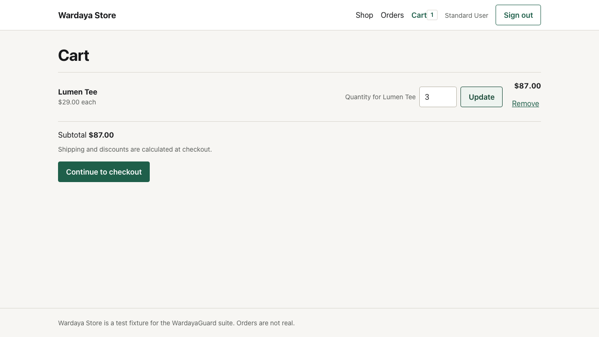

# WARD-INV-001: header badge shows 1 for three units

A trace-based investigation of [WARD-DEF-004](../defects/WARD-DEF-004-header-count.md).
The test fails on one assertion. The network is healthy. The page renders the
server values correctly. One derived value is wrong.

## Symptom

One cart line, Lumen Tee, quantity 3. The cart page shows:

- quantity `3`
- unit price `$29.00`
- line total `$87.00`
- subtotal `$87.00`

The header badge shows `1`.



The screenshot was captured before the v1.2.0 editorial redesign. The defect,
the values and the conclusion are unchanged; only the visual layer is older.

## Reproduction

```bash
npx playwright test --project=chromium --grep "CART-007" --trace on
```

The trace is retained on failure by configuration, so `--trace on` is only
needed to capture a passing run for comparison.

## Trace walkthrough

### 1. The request is correct

From `trace.zip`, the network entries include:

```
PATCH http://127.0.0.1:4173/api/cart/items/1
request:  {"quantity":3}
status:   200
response: {"items":[{"id":1,"productId":2,"name":"Lumen Tee",
           "unitPriceCents":2900,"quantity":3,"lineTotalCents":8700,
           "stock":30}],"subtotalCents":8700}
```

That eliminates the API, the proxy and the request payload in one step. This is
the first thing to check: a wrong screen does not mean a wrong server.

### 2. The page renders the response

The failure screenshot shows the same values the API returned: quantity 3,
`$29.00` each, `$87.00` line total, `$87.00` subtotal. So the cart page is
consuming the payload correctly.

### 3. The badge disagrees

Only one value is wrong:

```
Locator:  getByTestId('cart-count')
Expected: "3"
Received: "1"
```

The page snapshot at failure contains `<span class="count" data-testid="cart-count">1</span>`.

### 4. Localize the candidate formulas

The badge could plausibly be computed two ways:

| Candidate            | Value for this cart |
| -------------------- | ------------------- |
| `cart.items.length`  | 1                   |
| `sum(item.quantity)` | 3                   |

The observed value is exactly the first candidate, which points at the
aggregate rather than at missing data.

### 5. Confirm in source

`apps/storefront/src/cart.tsx`:

```ts
const count = cart.items.length;
```

The value is derived in the provider and used only by the header, which is why
the rest of the page stays correct.

## Root cause

A derived value used the wrong aggregate. The cart state was correct, the
server was correct, and the view model for the badge was wrong.

## Why the existing suite missed it

Every earlier assertion on the badge followed a single-unit add, where both
formulas agree:

- 1 line, 1 unit: `items.length === 1`, `sum(quantity) === 1`.

CART-001 and CART-002 changed the quantity to 2 and asserted the line and the
subtotal, but never the badge. The test data made two different formulas produce
the same number, so the gap was invisible.

The new test uses 1 line with 3 units, which separates the candidates. That is
the smallest input that proves which formula is in use.

## Fix

```ts
const count = cart.items.reduce((total, item) => total + item.quantity, 0);
```

## Verification

- `CART-007` fails before the fix and passes after it.
- The full UI suite passes on Chromium and WebKit locally, and on all three
  engines in the nightly workflow.
- The API suite is unaffected, which is expected: it never knew about this bug.

## What the trace proved

- No console error and no failed request. The defect is silent at the network
  layer.
- The API and the cart page were correct; the fault was in a derived view value.
- Checking the network first removed the backend from the suspect list
  immediately, instead of debugging the wrong layer.

## Lessons

- A healthy network tab and a wrong screen are compatible. Check both.
- Assert the number the user sees, not only the data below it.
- Choose test data that separates competing implementations. One line with
  three units is stronger than three lines with one unit.
- A trace is a timeline plus DOM plus network. The three together turn "the
  badge is wrong" into "the badge uses the wrong aggregate" in five steps.
